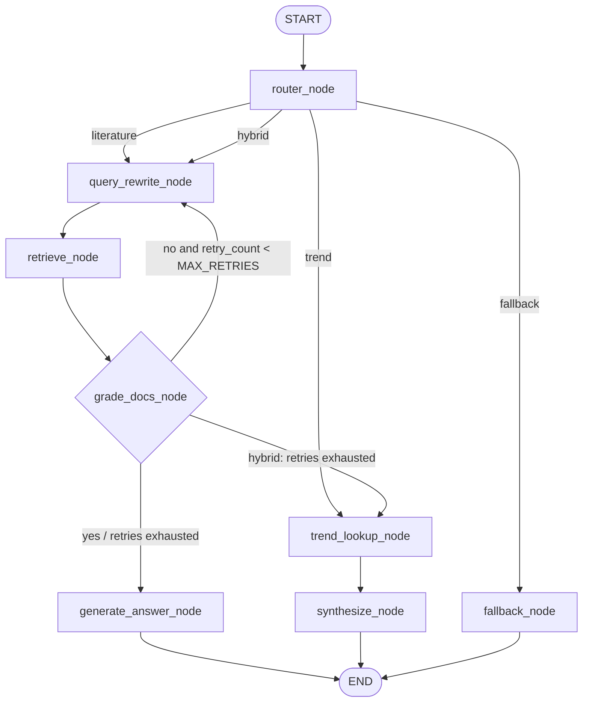

# Research Paper Discovery and Trend Analysis

A reproducible arXiv paper-discovery pipeline and question-answering app for `cs.LG`, `cs.CL` and `cs.CV` papers from 2018 to 2024.

**Repository:** [github.com/MohammadIbraheem71/research_paper_discovery](https://github.com/MohammadIbraheem71/research_paper_discovery)

---

## Problem statement

Build a reproducible system that:

1. prepares a large arXiv snapshot for machine learning and retrieval;
2. preserves a stable dataset contract and prevents train/test leakage;
3. classifies papers into three primary categories;
4. discovers topics and measures how their shares change over time;
5. answers natural-language questions using retrieved papers and trend evidence;
6. reports results from hand-verified evaluation data.

The final application supports four question types:

| Route | Meaning | Example |
|---|---|---|
| `literature` | Find and summarize papers | “Find papers about low-resource machine translation” |
| `trend` | Analyze topic change over time | “Track the popularity of diffusion models over the years” |
| `hybrid` | Papers plus trend | “Show papers about CLIP and how their topic share trends over time” |
| `fallback` | Off-topic or unanswerable question | “What is the weather tomorrow?” |

---

## Dataset details

### Source and scope

- **Raw source:** [Cornell University arXiv Dataset](https://www.kaggle.com/datasets/Cornell-University/arxiv).
- **Primary categories:** `cs.LG`, `cs.CL`, `cs.CV`.
- **Date window:** first-version submission year 2018–2024 inclusive.
- **Balancing cap:** 40,000 papers per primary category, seed 42.
- **Sampling note:** the final dataset is balanced by design, not by natural arXiv distribution.

### Published datasets

| Dataset | Contents |
|---|---|
| [arXiv Papers Cleaned](https://www.kaggle.com/datasets/mohammadibraheem71/arxiv-papers-cleaned) | `papers_raw.parquet` (120,000 rows), `papers.parquet` (119,919 rows), `papers_sample.parquet` (10,000 rows) |
| [arXiv Papers Embeddings](https://www.kaggle.com/datasets/mohammadibraheem71/arxiv-papers-embeddings) | `embeddings.npy`, 119,919 × 384 L2-normalized vectors in exact `papers.parquet` row order |

### Final class distribution

| Category | Papers |
|---|---:|
| `cs.CL` | 39,980 |
| `cs.CV` | 39,973 |
| `cs.LG` | 39,966 |
| **Total** | **119,919** |

The original uncapped snapshot contained 236,619 matching papers:

| Category | Papers | Share |
|---|---:|---:|
| `cs.CV` | 96,756 | 40.89% |
| `cs.LG` | 87,945 | 37.17% |
| `cs.CL` | 51,918 | 21.94% |

Yearly uncapped totals grow from 14,971 papers in 2018 to 58,861 in 2024. Claims about real arXiv volume or imbalance must use the uncapped counts, not the capped sample.

### Dataset columns

| Column | Description |
|---|---|
| `id` | arXiv identifier |
| `title` | cleaned title |
| `abstract` | cleaned abstract |
| `text_raw` | title + abstract with LaTeX/URLs removed; case and punctuation kept |
| `text_lemma` | lowercased, stop-word-free, lemmatized text |
| `primary_category` | target label: `cs.LG`, `cs.CL` or `cs.CV` |
| `categories` | all arXiv categories, space-separated |
| `date` | first-version submission date |
| `year` | submission year |
| `month` | submission month |
| `quarter` | submission quarter, e.g. `2021Q3` |

`text_raw` is used for sentence embeddings, LLM prompts and retrieval. `text_lemma` is used for TF-IDF and topic modeling.

The final table is sorted once by `id` and must never be re-sorted: embeddings and downstream artifacts depend on that row order.

---

## Phase 1 work

Phase 1 built the data foundation used by every later stage.

| Stage | Work | Main files |
|---|---|---|
| Shared config | Froze categories, years, cap, seed and embedding settings | `src/config.py` |
| A1 filtering | Streamed the raw JSON snapshot, kept the selected categories and years, capped to 40k per class | `src/preprocessing.py` |
| A1b uncapped counts | Recomputed category and year counts without the cap | `src/uncapped_counts.py`, `notebooks/04_uncapped_counts.ipynb` |
| A2 cleaning | Removed bad records, cleaned text, built `text_raw`/`text_lemma`, derived date features and validated the contract | `src/cleaning.py`, `notebooks/01_data_cleaning.ipynb` |
| EDA | Studied class balance, lengths, cross-listing, vocabulary, correlations and time trends | `notebooks/02_eda.ipynb` |
| Feature preparation | Encoded labels, made the stratified 80/20 split, built TF-IDF/numeric features and a CPU-safe embedding demo | `notebooks/03_preprocessing.ipynb` |
| Full embeddings | Generated all 119,919 × 384 embeddings on Kaggle GPU and verified row alignment | `notebooks/00_kaggle_embeddings.ipynb`, `src/embed_all.py` |

### Cleaning progression

| Stage | Rows |
|---|---:|
| Raw filtered data after A1 | 120,000 |
| After missing values, duplicate ids/normalized titles and withdrawn notices | 119,970 |
| After removing abstracts under 30 words | 119,919 |

Cleaning removed 0 missing values, 0 duplicate ids, 29 near-identical titles, 1 withdrawn-paper notice and 51 too-short abstracts. Length outliers were documented but kept because they are legitimate papers and would break embedding row alignment if removed.

### Key EDA findings

- The capped dataset is balanced by construction.
- Abstracts have a median of about 168 words; titles have a median of about 9.
- Abstract length is a weak category discriminator.
- 69,412 papers, about 58%, are cross-listed, so `primary_category` is sometimes ambiguous.
- Category-specific terms are highly informative, while generic words such as “model”, “base” and “datum” appear across all classes.
- Report macro-F1 and per-class errors, especially for `cs.LG`.

---

## Models and pipeline used

### Phase 2 architecture



### Module map

| Module | Responsibility |
|---|---|
| `src/contracts.py`, `src/settings_p2.py` | frozen types, constants and paths |
| `src/llm.py` | LLM calls with disk cache, retry/backoff and JSON mode |
| `src/rag.py` | FAISS retrieval, metadata filters and grounded answer generation |
| `src/topics.py` | LDA and BERTopic topic modeling |
| `src/trends.py` | quarterly topic share, slopes, lookup and chart generation |
| `src/classify.py` | four classifier variants and metrics |
| `src/nodes.py`, `src/graph.py` | graph nodes, retry loop and LangGraph wiring |
| `src/evaluate.py`, `eval/` | hand-labelled gold files and evaluation helpers |
| `app.py` | Streamlit question-answering interface |

### Topic modeling

- **LDA:** 20 topics, c_v 0.5605.
- **BERTopic:** 24 non-outlier topics, c_v 0.5629, outlier share 0.4282.
- BERTopic uses the Phase 1 embeddings; LDA uses `text_lemma`.
- Topic labels are heuristic drafts from the top three words.

### Trend analysis

- `results/topic_share.csv` contains 656 rows over 28 quarters and 24 non-outlier topics.
- Outlier topic `-1` is excluded from the topic-share numerator but retained in the quarterly denominator.
- Slopes are fitted with ordinary least squares.
- Trend questions are matched to topic labels by word overlap and `difflib.SequenceMatcher`.
- Charts are written to `results/trends/topic_trend_<topic_id>.png` and displayed inline in the app.

### Classification

Four variants were compared on the Phase 1 stratified split:

| Model | Features |
|---|---|
| `logreg` | TF-IDF |
| `nb` | TF-IDF |
| `svm` | TF-IDF |
| `logreg_emb` | sentence embeddings |

### Retrieval and answer generation

- FAISS `IndexFlatIP` over 119,919 L2-normalized vectors.
- Query embeddings use `all-MiniLM-L6-v2`, dimension 384.
- Hard filters support year range, primary category and BERTopic topic.
- `TOP_K = 5`.
- LLM answers are grounded in retrieved abstracts and must cite papers as `[arXiv:ID]`.
- If the answer contains no valid citation, the system returns `not enough evidence`.

### LLM and graph

- One provider key is required for real LLM calls: `GROQ_API_KEY` or `GEMINI_API_KEY`.
- The executed evaluation used `LLM_MODEL=openai/gpt-oss-20b` through Groq.
- `src/llm.py` caches prompts by hash and retries with exponential backoff.
- The graph allows up to 2 retries when document grading fails.
- Graph state is persisted per `thread_id` using SQLite in `cache/phase2_checkpoints.sqlite`.

---

## Final results

### Phase 1

| Result | Value |
|---|---:|
| Raw filtered papers | 120,000 |
| Final cleaned papers | 119,919 |
| `cs.CL` / `cs.CV` / `cs.LG` | 39,980 / 39,973 / 39,966 |
| Train / test rows | 95,935 / 23,984 |
| Embedding shape | 119,919 × 384 |

### Topic modeling

| Model | Topics | c_v | Outlier share |
|---|---:|---:|---:|
| LDA | 20 | 0.5605 | 0 |
| BERTopic | 24 | 0.5629 | 0.4282 |

Notable trend slopes:

| Topic | Slope | p-value |
|---|---:|---:|
| Language / Model / Text | +0.000709 | 0.279 |
| Series / Time / Forecasting | +0.000515 | 3.28e-05 |
| Image / Segmentation / Detection | -0.001725 | 4.59e-07 |
| Policy / Reinforcement / Learning | -0.000602 | 0.000926 |

### Classification

| Model | Accuracy | Macro-F1 |
|---|---:|---:|
| `logreg` | 0.9221 | 0.9221 |
| `nb` | 0.9101 | 0.9100 |
| `svm` | 0.9255 | 0.9255 |
| `logreg_emb` | 0.9159 | 0.9158 |

The best model is `svm`. `cs.LG` is the hardest class because of cross-listing overlap.

### Retrieval, ablation and routing

Verified from `notebooks/10_evaluation.ipynb` and committed result files.

| Retrieval metric | Value |
|---|---:|
| Hit Rate@1 | 0.9333 |
| Hit Rate@5 | 1.0 |
| Hit Rate@10 | 1.0 |
| MRR | 0.9567 |

Ablation over 30 questions:

| Variant | Hit Rate@5 | Mean RR | Avg LLM calls |
|---|---:|---:|---:|
| with rewrite+grade | 0.9 | 0.838889 | 4.2 |
| without rewrite+grade | 1.0 | 0.898333 | 0.0 |

Direct retrieval without rewrite/grade performed better on this verified eval set while using fewer LLM calls.

| Router metric | Value |
|---|---:|
| Questions | 40 |
| Accuracy | 1.0 |
| Correct predictions | 40 |

The router confusion matrix is diagonal with 10 questions per route.

### Human verification

| Artifact | Result |
|---|---|
| `eval/label_decisions.csv` | 521 reviewed rows |
| Relevant decisions | 465 `y` |
| Irrelevant decisions | 56 `n` |
| `eval/eval_retrieval.json` | all 30 questions have `needs_human_verification: false` |
| `eval/citation_sample.csv` | 20 sampled citations, all `supported? = y` |

### Tests

```bash
python -m pytest -q
```

Result:

```text
7 passed
```

Tests cover imports, retrieval document shapes and filters, all four routes, the retry loop, the `TrendData` contract, ranking metrics and eval JSON structure. Tests are offline and need no API key or GPU. The real retrieval test does require the local `data/embeddings.npy` and `data/doc_topics.parquet` assets from Section 3, so place those first.

---

## How to run the project

### 1. Clone and install

```bash
git clone https://github.com/MohammadIbraheem71/research_paper_discovery.git
cd research_paper_discovery

python3.12 -m venv .venv
source .venv/bin/activate
python -m pip install -r requirements.txt
python -m spacy download en_core_web_sm
```

### 2. Configure the environment

```bash
cp .env.example .env
```

Edit `.env` and add **one** provider key:

```text
GROQ_API_KEY=...
```

or:

```text
GEMINI_API_KEY=...
```

Optionally set a currently available model id:

```text
LLM_MODEL=openai/gpt-oss-20b
```

`.env` is gitignored and secrets are never printed. To check non-secret configuration variables:

```bash
python -m src.check_env
```

### 3. Put the required data assets in place

Download [arXiv Papers Cleaned](https://www.kaggle.com/datasets/mohammadibraheem71/arxiv-papers-cleaned) and place:

```text
papers.parquet
```

in `data/`.

Download [arXiv Papers Embeddings](https://www.kaggle.com/datasets/mohammadibraheem71/arxiv-papers-embeddings) and place:

```text
embeddings.npy
```

in `data/`.

Retrieval also needs:

```text
data/doc_topics.parquet
```

Generate it by running `notebooks/05_topic_modeling.ipynb`, or place an already generated copy in `data/`. This file is intentionally not committed.

The trend table `results/topic_share.csv` is already tracked.

### 4. Optional full reproduction

Phase 1 notebooks:

```text
notebooks/01_data_cleaning.ipynb
notebooks/02_eda.ipynb
notebooks/03_preprocessing.ipynb
```

Notebook `04_uncapped_counts.ipynb` is separate and needs the original Cornell snapshot attached on Kaggle.

Full-corpus embedding generation is Kaggle/GPU only:

```bash
python src/embed_all.py \
  --papers /kaggle/input/datasets/mohammadibraheem71/arxiv-papers-cleaned/papers.parquet \
  --out /kaggle/working/embeddings.npy \
  --check results/embeddings_check.json
```

Phase 2 notebooks:

```text
notebooks/05_topic_modeling.ipynb
notebooks/06_trends.ipynb
notebooks/07_classification.ipynb
notebooks/09_langgraph.ipynb
```

`notebooks/08_rag.ipynb` is a skeleton walkthrough; the real RAG implementation is in `src/rag.py`.

Do **not** rerun `notebooks/10_evaluation.ipynb` unless you are prepared to refill `eval/citation_sample.csv`; rerunning it blanks the `supported?` column.

A notebook can be executed from the repo root with:

```bash
jupyter nbconvert --to notebook --execute --inplace \
  --ExecutePreprocessor.timeout=-1 notebooks/02_eda.ipynb
```

### 5. Run tests

```bash
python -m pytest -q
```

### 6. Run the app

```bash
.venv/bin/python -m streamlit run app.py
```

Open:

```text
http://localhost:8501
```

Try these prompts:

```text
Find papers about low-resource machine translation
Track the popularity of diffusion models over the years
Show papers about CLIP and how their topic share trends over time
What is the weather tomorrow?
```

More examples are in `sample_questions.txt`.

---

## Repository structure

```text
data/          local parquet/npy inputs; ignored by git
eval/          hand-labelled retrieval/routing gold files and review worksheets
images/        plots from cleaning, EDA, classification and evaluation
notebooks/     Phase 1 and Phase 2 notebooks
results/       small tracked manifests, CSVs and committed result artifacts
src/           reusable pipeline, retrieval, LLM, graph and evaluation modules
tests/         skeleton and contract tests
app.py         Streamlit interface
sample_questions.txt
```

---

## Team contributions

### Ibraheem

- shared configuration and frozen Phase 2 contracts;
- A1 filtering, A2 cleaning and uncapped counts;
- full-corpus embedding job;
- topic modeling, trend analysis and chart generation;
- LangGraph wiring, SQLite checkpointer and graph node integration;
- label review tooling, human label application and Stage 4 artifacts.

### Sohaib

- exploratory data analysis and EDA insights;
- classification comparison;
- router, fallback and synthesis nodes;
- router accuracy evaluation.

### Aliyan

- preprocessing, label encoding, split and feature preparation;
- LLM access layer with cache, retry/backoff and JSON mode;
- FAISS retrieval and grounded answer generation;
- retrieval and ablation evaluation;
- Streamlit interface.

---

## Limitations and notes

- The 40,000-per-category cap makes the dataset balanced by construction; results do not describe natural arXiv proportions.
- `primary_category` is a single label even though many papers are cross-listed.
- Topic labels are heuristic drafts from top words and still need human review.
- BERTopic leaves 42.82% of papers as outliers; these are excluded from topic-share numerators.
- `notebooks/08_rag.ipynb` is a skeleton; the implemented RAG path lives in `src/rag.py` and the graph.
- Rerunning `notebooks/10_evaluation.ipynb` regenerates `eval/citation_sample.csv` and clears the citation review column.
- Real LLM answers require one provider key; importing and testing the project does not.
